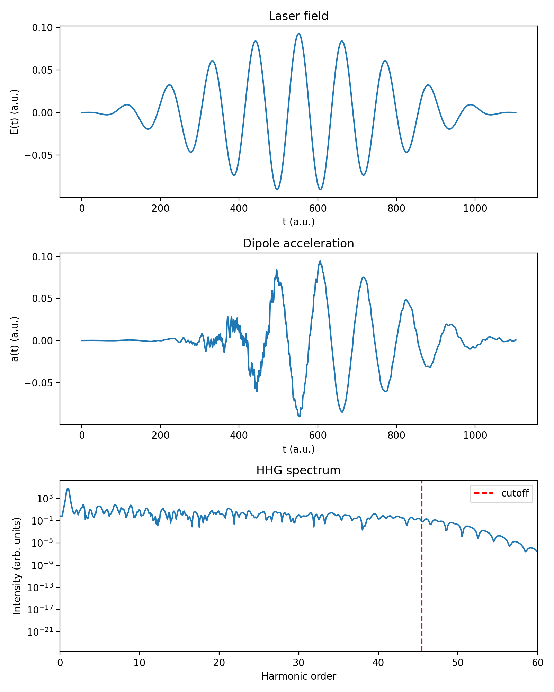

# 1D TDSE Simulation of High Harmonic Generation (HHG)

A compact Python code that solves the one-dimensional time-dependent Schrödinger equation (TDSE) for a model atom in a strong, few-cycle laser pulse, and extracts the high harmonic generation (HHG) spectrum from the dipole acceleration.

The code is written in atomic units and uses the split-operator (FFT) method.



*Top: driving laser field. Middle: dipole acceleration. Bottom: HHG spectrum with the cutoff predicted by the three-step model (red dashed line).*

## Physical model

| Ingredient | Choice |
|---|---|
| Atom | 1D soft-core potential `V(x) = -1 / sqrt(x² + a²)`, `a² = 2` (ionization potential Ip ≈ 0.5 a.u.) |
| Interaction | Length gauge: `H(t) = p²/2 + V(x) + x·E(t)` |
| Laser field | `E(t) = E0 · sin²(π t / T_total) · cos(ω0 t)` |
| Wavelength | 800 nm (`ω0 ≈ 0.0570 a.u.`) |
| Intensity | 3 × 10¹⁴ W/cm² (`E0 ≈ 0.0924 a.u.`) |
| Pulse duration | 10 optical cycles |
| Spatial grid | `x ∈ [-200, 200] a.u.`, 4096 points |
| Time step | `dt = 0.05 a.u.` |

## Parameter guide

All quantities are in atomic units (a.u.) unless stated otherwise. The input parameters are set at the top of `main()`.

### Input parameters

| Variable in code | Default | Unit | Meaning | Effect of changing it |
|---|---|---|---|---|
| `wavelength_nm` | `800.0` | nm | Wavelength of the driving laser | Longer wavelength gives a larger `Up ∝ λ²` and a much higher cutoff |
| `intensity_wcm2` | `3e14` | W/cm² | Peak laser intensity | Higher intensity gives a larger `Up ∝ I` and a higher cutoff (more ionization, depletion) |
| `n_cycles` | `10` | cycles | Pulse duration in optical cycles | More cycles give sharper harmonic peaks; fewer cycles give a broad, continuous spectrum |
| `a2` | `2.0` | a.u. | Soft-core parameter `a²` in `V(x) = -1/sqrt(x² + a²)` | Sets the ground-state energy and `Ip` (`a² = 2` gives `Ip ≈ 0.5`) |
| `x_max` | `200.0` | a.u. | Half-length of the spatial grid, `x ∈ [-x_max, x_max]` | Must be much larger than the quiver amplitude `α0 = E0/ω0²` |
| `nx` | `4096` | – | Number of grid points | More points give a finer grid and a larger maximum momentum, but slower runs |
| `dt` | `0.05` | a.u. | Time step of the real-time propagation | Smaller is more accurate but slower |

### Numerical settings inside the functions

| Setting | Value | Where | Meaning |
|---|---|---|---|
| `dtau` | `0.05` | `ground_state` | Imaginary-time step |
| `max_steps` | `20000` | `ground_state` | Maximum number of imaginary-time steps |
| `tol` | `1e-10` | `ground_state` | Energy convergence threshold |
| `x_abs` | `0.8 · x_max` | `absorber` | Position where the absorbing mask starts |
| mask exponent | `1/8` | `absorber` | Shape of the `cos^(1/8)` mask |
| window | `sin²(π t / T_total)` | `hhg_spectrum` | Window applied to the dipole acceleration before the FFT |
| `3.17` | – | `cutoff` | Coefficient of `Up` in the cutoff law |

### Conversion constants

| Constant | Value | Use |
|---|---|---|
| `45.5634` | – | `ω0 = 45.5634 / λ[nm]` (photon energy in a.u.) |
| `3.51e16` | W/cm² | One atomic unit of intensity: `E0 = sqrt(I / 3.51e16)` |

### Derived quantities (for the default parameters)

| Quantity | Formula | Value |
|---|---|---|
| Laser frequency `w_0` | `45.5634 / λ` | ≈ 0.0570 a.u. (photon energy ≈ 1.55 eV) |
| Field amplitude `E_0` | `sqrt(I / 3.51e16)` | ≈ 0.0924 a.u. |
| Optical period `T` | `2π / w_0` | ≈ 110.3 a.u. (≈ 2.67 fs) |
| Pulse length `T_total` | `n_cycles · T` | ≈ 1103 a.u. (≈ 26.7 fs) |
| Number of time steps `nt` | `T_total / dt` | ≈ 22,000 |
| Grid spacing `dx` | `2 · x_max / nx` | ≈ 0.098 a.u. |
| Absorber start `x_abs` | `0.8 · x_max` | 160 a.u. |
| Quiver amplitude `α0` | `E_0 / w_0²` | ≈ 28.5 a.u. |
| Ponderomotive energy `Up` | `E_0² / (4 w_0²)` | ≈ 0.659 a.u. |
| Cutoff harmonic order | `(Ip + 3.17 Up) / w_0` | ≈ 45 |

### Rules of thumb when changing parameters

- Keep `x_max` several times larger than `α0`, and keep the absorber region (`x_abs` to `x_max`) free of the bound state.
- If you increase the intensity or the wavelength, check that the cutoff harmonic still fits in the plotted range (`xlim` in `plot_results`).
- Keep `dt` small compared with the optical period (`dt ≪ T`). If the spectrum changes when `dt` is halved, the step was too large.

## Numerical method

1. **Ground state** by imaginary-time propagation (split-operator), renormalizing the wavefunction after every step until the energy converges.
2. **Real-time propagation** with the second-order split-operator scheme:
   ```
   ψ ← exp(-i V_tot dt/2) ψ
   ψ ← IFFT[ exp(-i k² dt/2) FFT[ψ] ]
   ψ ← exp(-i V_tot dt/2) ψ
   ```
   where `V_tot = V(x) + x·E(t + dt/2)`.
3. **Absorbing boundary:** a `cos^(1/8)` mask function near the edges of the grid prevents unphysical reflections of the outgoing wavepacket.
4. **Dipole acceleration** from the Ehrenfest theorem:
   ```
   a(t) = -<ψ| dV/dx |ψ> - E(t)
   ```
5. **HHG spectrum:** `S(ω) = |FFT[a(t) · w(t)]|²`, with a `sin²` window `w(t)`, plotted against the harmonic order `ω / ω0`.
6. **Cutoff law** for comparison:
   ```
   E_cutoff = Ip + 3.17 Up,     Up = E0² / (4 ω0²)
   ```
   For the parameters above, the cutoff is at harmonic order ≈ 45.

## Results

- The spectrum shows the typical HHG structure: a strong peak at the fundamental frequency, a rapid decrease over the first harmonics, a **plateau**, and a sharp drop beyond the **cutoff**.
- The end of the plateau agrees with the cutoff predicted by the three-step model (`Ip + 3.17 Up`, harmonic ≈ 45).
- Because the pulse is short, the harmonic peaks are broad, and the spectrum becomes nearly continuous close to the cutoff. This is the region used to generate isolated attosecond pulses.

## Installation and usage

```bash
git clone https://github.com/alirezacs50/HHG-TDSE1D.git
cd HHG-TDSE1D
pip install -r requirements.txt
python main.py
```

The script prints the ground-state energy and the cutoff harmonic, saves the spectrum to `hhg_spectrum.npy`, and saves the figure to `hhg_result.png`.

A full run takes from several seconds to a couple of minutes, depending on the machine. For a quick test, reduce `n_cycles` and `nx` inside `main()`.

## Code structure

| Function | Purpose |
|---|---|
| `Atomic_unit_parameetrs` | Converts wavelength, intensity and number of cycles to atomic units |
| `build_grids` | Builds the space grid `x`, the momentum grid `k` and the time grid `t` |
| `laser_field` | Laser electric field `E(t)` |
| `potential` | Soft-core potential and its derivative `dV/dx` |
| `ground_state` | Ground state and its energy (imaginary-time propagation) |
| `absorber` | Mask function at the grid boundaries |
| `propagate` | Real-time split-operator propagation, returns the dipole acceleration |
| `dipole_acceleration` | Dipole acceleration at one time step (Ehrenfest theorem) |
| `hhg_spectrum` | Windowed Fourier transform of the dipole acceleration |
| `cutoff` | Cutoff energy and harmonic order from the three-step model |
| `plot_results` | Plots the field, the dipole acceleration and the spectrum |

## Validation ideas

- Increase `x_max` or decrease `dt`: the spectrum should not change.
- Change the intensity (e.g. 1 × 10¹⁴ W/cm²): the cutoff should move to the predicted harmonic order.
- Switch the laser off: the dipole acceleration should stay (almost) zero.

## Possible extensions

- Filter a group of plateau harmonics and reconstruct an attosecond pulse in the time domain.
- Study the dependence of the cutoff on the driving wavelength (`Up ∝ λ²`).
- Compare with the Lewenstein (strong-field approximation) model.

## References

1. P. B. Corkum, *Plasma perspective on strong-field multiphoton ionization*, Phys. Rev. Lett. **71**, 1994 (1993).
2. J. L. Krause, K. J. Schafer, K. C. Kulander, *High-order harmonic generation from atoms and ions in the high intensity regime*, Phys. Rev. Lett. **68**, 3535 (1992).
3. J. L. Krause, K. J. Schafer, K. C. Kulander, *Calculation of photoemission from atoms subject to intense laser fields*, Phys. Rev. A **45**, 4998 (1992).
4. J. Javanainen, J. H. Eberly, Q. Su, *Numerical simulations of multiphoton ionization and above-threshold electron spectra*, Phys. Rev. A **38**, 3430 (1988).

## License

MIT License (add a `LICENSE` file to the repository).
